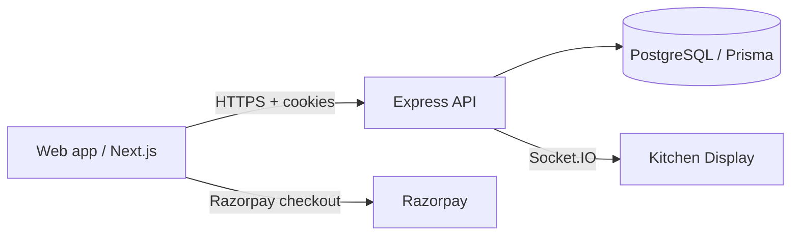

# Restaurant Management System

This repository contains the monorepo for a restaurant management system with a Next.js web app, an Express API, and shared validation code.

## Tech stack

- Web: Next.js App Router + TypeScript + Tailwind CSS
- API: Express + TypeScript + Socket.IO
- Database: PostgreSQL + Prisma
- Shared: Zod schemas and typed utilities
- Deploy: Vercel for the web app, Render/Railway for the API, Neon for PostgreSQL

## Local setup

1. Install dependencies:
   ```bash
   npm install
   ```
2. Copy the environment examples and update values:
   ```bash
   cp apps/api/.env.example apps/api/.env
   cp apps/web/.env.example apps/web/.env.local
   ```
   Generate a unique API secret and set `JWT_SECRET` in `apps/api/.env` (PowerShell):
   ```powershell
   node -e "console.log(require('node:crypto').randomBytes(32).toString('hex'))"
   ```
   The API refuses to start with a missing or placeholder JWT secret.
3. Apply the checked-in Prisma migration to a new database:
   ```bash
   npm exec --workspace=apps/api -- prisma migrate deploy
   npm exec --workspace=apps/api -- prisma db seed
   ```
   If the database already contains tables from `db push`, baseline it with Prisma before deploying migrations; do not run the initial migration against existing tables.
4. Start the API:
   ```bash
   npm run dev:api
   ```
5. Start the web app:
   ```bash
   npm run dev:web
   ```
6. Open the app at http://localhost:3000 and verify the API health check at http://localhost:4000/health

## Workspace scripts

- `npm run dev:api` — run the Express API in watch mode
- `npm run dev:web` — run the Next.js web app
- `npm run build:shared` — build the shared package
- `npm run typecheck` — perform TypeScript checks across workspaces
- `npm run lint` — run lint tasks across workspaces
- `npm test` — run the API test suite

## Route summary

- `/` — landing page
- `/login` — staff login
- `/t/[qrToken]` — customer menu
- `/order/[orderId]` — live tracking
- `/waiter` — waiter POS
- `/kitchen` — kitchen display
- `/cashier` — billing
- `/admin` — dashboard overview
- `/admin/menu` — menu management
- `/admin/tables` — table management
- `/admin/staff` — staff management
- `/admin/reports` — reports

## Hardening and deployment notes

The API is configured with a global rate limit, allow-listed CORS origins, Helmet security headers, and a sanitisation pass on request body/query/params before handlers run. All serious backend errors are logged centrally via the API logger, while validation still happens through shared Zod schemas and controller-level checks.



## Production deployment guide

### Web app

- Deploy the Next.js app on Vercel.
- Set `NEXT_PUBLIC_API_URL` to the production API origin.
- Ensure the app uses a secure production domain and cookie-compatible API host.

### API

- Deploy the API to Render or Railway.
- Set `PORT`, `DATABASE_URL`, `JWT_SECRET`, `CLIENT_URL`, `RAZORPAY_KEY_ID`, `RAZORPAY_KEY_SECRET`, and `RAZORPAY_WEBHOOK_SECRET` in the deployment environment.
- Use `ALLOWED_ORIGINS` as a comma-separated list of trusted origins.

### Database

- Provision a Neon PostgreSQL database and run Prisma migrations before initial deployment.
- Keep `DATABASE_URL` in the environment and avoid hard-coded secrets.

### Docker

A production-style API container is available at [apps/api/Dockerfile](apps/api/Dockerfile). Build it with:

```bash
docker build -f apps/api/Dockerfile -t tavola-api .
```

## Features at a glance

- Staff auth with JWT cookies and role enforcement
- Menu and category management
- Table QR access and table status tracking
- Customer ordering flow and live order tracking
- Kitchen, waiter, cashier and admin views
- Reports and filters for revenue and performance
- Decimal-based report totals with CSV export
- Audit logging and staff management controls
- Payment preparation and webhook verification

## Demo credentials

- Admin: admin@tavola.com / password123
- Manager: manager@tavola.com / password123
- Cashier: cashier@tavola.com / password123
- Waiter: waiter@tavola.com / password123
- Chef: chef@tavola.com / password123
- Customer: customer@tavola.com / password123

## Screenshots placeholder

- Landing page hero and QR flow
- Customer menu grid and cart sheet
- Kitchen ticket board
- Waiter table map and billing screen
- Admin dashboard and staff tools
